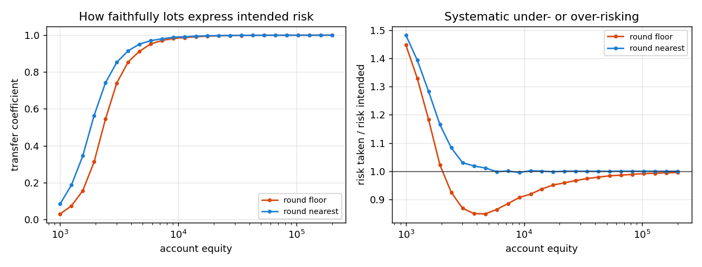
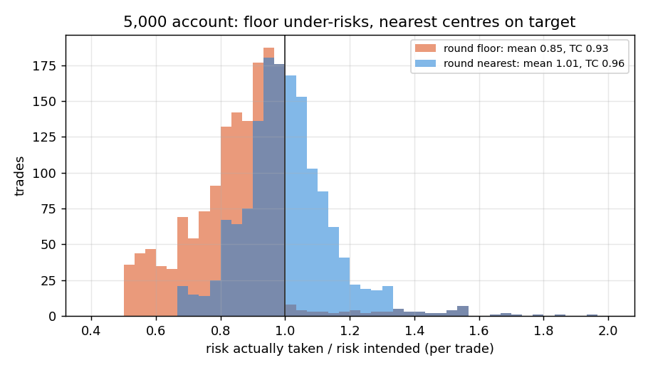

# lotsizing: risk-based position sizing that survives a small account

[](https://github.com/Tolbert-Okoth/small-account-sizing/actions/workflows/tests.yml)


"Risk 0.25 % per trade" is easy to write and hard to execute. Lots come in steps (0.01), have a minimum, and stop distances vary trade by trade, so on a small account the risk you **actually** take can be far from the risk you **intended**:
- **Floor rounding** (the common default) quietly **under-risks** every trade.
- **The minimum lot** forces **over-risking** on the smallest accounts, or silently skips trades.
- **Conviction tilts** (bigger size on better setups) get flattened, so part of the strategy's skill never reaches the P&L.

`lotsizing` gives you:
- **`size_trade`:** a tested sizing function with floor or nearest rounding, a **hard risk cap**, and an explicit policy for trades below the minimum lot. Every decision returns a status you can log.
- **Analysis tools:** they measure how much of the intended risk profile survives. Grinold and Kahn's **transfer coefficient (TC)**, IR retention, risk taken ÷ risk intended, and skip and forced-minimum shares, all as functions of account size.



## What the demo shows (1,500 synthetic trades, 0.25 % base risk, conviction tilts 0.5/1/1.5, cap 0.75 %)
| Account | Rounding | Transfer coefficient | Risk taken / intended | Forced to min lot | Skipped |
|---|---|---|---|---|---|
| 1,000 | floor | 0.03 | 145 % | 71 % | 9 % |
| 5,000 | floor | 0.93 | **86 %** | 5 % | 0 % |
| 5,000 | nearest | **0.96** | **101 %** | 0 % | 0 % |
| 10,000 | floor | 0.99 | 92 % | 0 % | 0 % |
| 50,000 | either | 1.00 | 98–100 % | 0 % | 0 % |

- **At 1,000:** the sizing rule no longer expresses the strategy at all (TC 0.03). Most trades are the minimum lot, and the account runs at about 1.5× its intended risk.
- **At 5,000:** floor rounding silently takes 14 % less risk than planned. Rounding to the nearest step, with the cap as a guard, fixes it.



## Why I built it
- **Lot granularity is invisible in most backtests, which size in fractional units.** When I measured it on my own multi-strategy book at a 10,000 account, it was costing a large part of the backtest's information ratio.
- **Switching from floor to nearest rounding, with a hard cap as the guard, recovered about half of that loss.** It needed no strategy change.
- This package is the generic, tested version of that sizing logic and analysis.

## Quick start
```bash
pip install "git+https://github.com/Tolbert-Okoth/small-account-sizing.git#egg=lotsizing[plot]"
```
```python
import lotsizing as ls

spec = ls.SymbolSpec(tick_size=0.01, tick_value=1.0, min_lot=0.01, lot_step=0.01)   # from your platform's symbol info
s = ls.size_trade(equity=5_000, risk_frac=0.0025, stop_distance=4.2, spec=spec, cap_frac=0.0075, rounding="nearest")
print(s)        # Size(lots=0.03, risk=12.6, risk_frac=0.00252, status='ok')

# how well would my sizing express the strategy at different account sizes?
tab = ls.tc_by_capital([2_000, 5_000, 10_000, 50_000], weights, stop_distances, 0.0025, spec, 0.0075, edge=0.08 * weights)
print(ls.fundamental_law_ir(ic=0.05, breadth=400, tc=tab.tc.iloc[0]))
```

## API
| Function | What it does |
|---|---|
| `size_trade(equity, risk_frac, stop_distance, spec, cap_frac, rounding, below_min)` | Lots plus status: `ok`, `ok_capfloor`, `forced_min`, `skip_cap`, `skip_min` or `skip_invalid` |
| `loss_per_lot(spec, stop_distance)` | Account currency lost per 1.0 lot at the stop |
| `realised_vs_target(equity, weights, stops, base, spec, cap)` | Per-trade intended vs actual risk |
| `transfer_coefficient(target, realised)` | Correlation of intended and actual risk |
| `ir_retention(target, realised, edge)` | Share of the ideal IR kept, by simulation |
| `tc_by_capital(equities, ...)` | All of the above across account sizes and rounding rules |
| `fundamental_law_ir(ic, breadth, tc)` / `implied_ic(ir, breadth, tc)` | IR = IC·√BR·TC and its inverse |

## Design choices
- **Status codes rather than silent behaviour.** A forced minimum lot or a skipped trade is a decision your logs should show.
- **Nearest rounding with a cap guard.** When rounding up would breach the hard cap, it falls back to floor (`ok_capfloor`), so the cap is never exceeded.
- **Float safety at exact half steps.** For example, 0.15 / 0.01 is 14.999… in binary.

## Who this is for
- **Prop-firm and small-account traders:** a per-trade risk cap is a hard rule there, and under-risking quietly costs returns.
- **EA and bot developers:** a drop-in, unit-tested sizing core with auditable decisions.
- **Teams and clients:** I offer reviews of sizing and risk rules for automated strategies. Contact via my GitHub profile.

## Data and licensing
- **No market or broker data is included.** The demo uses synthetic trades and a generic contract specification.
- Code: MIT License (see `LICENSE`).

## References
- Grinold, R. & Kahn, R. (2000). *Active Portfolio Management*, 2nd ed., McGraw-Hill: the fundamental law of active management.
- Clarke, R., de Silva, H. & Thorley, S. (2002). *Portfolio Constraints and the Fundamental Law of Active Management.* Financial Analysts Journal: the transfer coefficient.

## Disclaimer
Research and educational software. Not investment advice, and no warranty: see `LICENSE`. Test any sizing code on a demo account before using it with real money.
